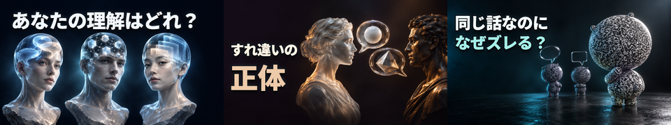
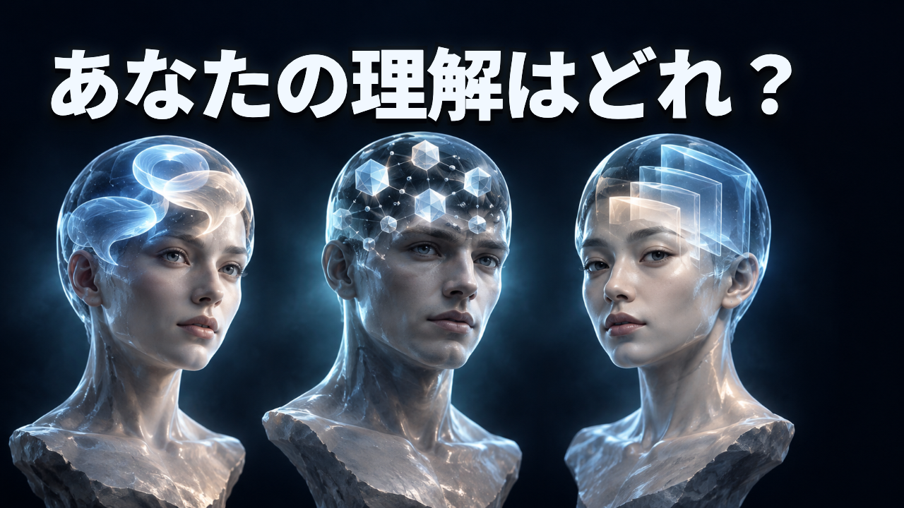
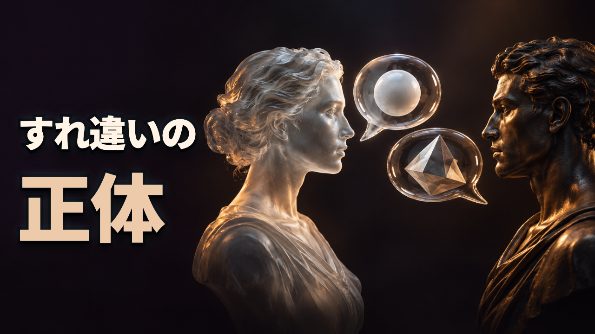
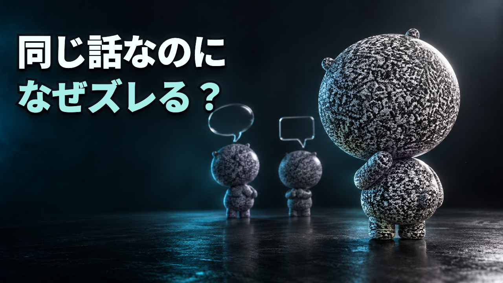

# IQ回 サムネイル・ラフ3案

**最新版は [v4/README.md](v4/README.md)。参考チャンネルの明朝体を活かし、デザイン性を増やす・3色に限定しないという最新指示に対応。v1〜v3は比較履歴として保存。**

2026-10-31 / Codex制作 / **試作・Claude未監査・方向選択待ち**。

依頼: [codex_request_thumbnail.md](../../codex_request_thumbnail.md)。入力は `codex/weekly-operations-20261025` の `122760fe8689cfac84ed1c50241dc8ceab1f1cb0`。ゲートA承認ではなく、完成版ではない。変更はこのフォルダのみ。

## 3案の違い

| 案 | コピー（句読点込み・改行除外） | 構図と主役 | 採用パターン |
|---|---|---|---|
| 1 | あなたの理解はどれ？ / **10字・1行** | 同じサイズの透明な人物胸像3体を横並び。頭内の形が異なる。上に大きな問い | 1・2・3 |
| 2 | すれ違いの / 正体 / **7字・2行** | 右に向かい合う胸像2体。丸と角の吹き出しで解釈の食い違い。左にコピー | 1・3・4 |
| 3 | 同じ話なのに / なぜズレる？ / **12字・2行** | 既存CRTマスコットを右前景に大きく、後方に会話する同じキャラ2体。左上に問い | 1・3・4 |

番号は[既存分析 §2](../../thumb_benchmark_2026-10-31.md)に対応。1=人物を並べた違い、2=視聴者への問い、3=短い最大文字、4=正体・問い直し。これらは再生傾向からの仮説でありCTRの因果効果を実証したものではない。

### 案1

- 差別化: 下の黄色帯を使わず上部に白い極太文字。透明ガラスの立体感と局所光で、漫画調の比較を避ける。
- 差別化: 頭の大きさ・照明・表情に優劣をつけず、同じ高さで異なる理解を示す。IQ値・順位は置かない。
- 参考パターンからの変更: IQの高低の序列から、解釈の違いへ。主コピーも独自の問いに変更。
- 本編で回収する約束: 自分がどの場面で理解のズレを経験するか考えられる説明。画像の3人は「3分類」の研究上の主張ではない。検査や診断結果ではない。

### 案2

- 差別化: 黒紫の余白＋左右の立体胸像＋ガラスの吹き出し。黄色帯・明朝体・概念1語だけの構成を避ける。
- 差別化: 怖い顔や劣った人物ではなく、同じ会話に異なる解釈が返る状況を主役にする。人物は同じサイズ・落ち着いた表情。
- 参考パターンからの変更: 左右比較を、対等に向かい合う関係へ。コピーは「すれ違い」の理由に絞る。
- 本編で回収する約束: 会話がすれ違う場面とその仕組み。全ての人間関係の原因を解明すると誤読されないよう、完成版でタイトルとの組み合わせを照合する。

### 案3（キャラを継続登場させる方向の推奨）

- 差別化: 既存オリジナルCRTキャラを前景の主役にし、チャンネルを認識する印にする。
- 差別化: 黒緑の空間・白黒の素材・青緑の控えめな文字光。人の賢さの序列ではなく、キャラが会話の食い違いを観察する構図。
- 参考パターンからの変更: 人物を等間隔に並べるだけでなく、観察者の前景と会話する2体の後景で視点をつくる。
- 本編で回収する約束: 同じ話から異なる理解が生じる場面と、自分・相手のための対処。大きさの違いは遠近と主役の強調であり、知能の差ではない。
- キャラ照合: `pilots/sleep-emotion-60s/preview.mp4` の8秒を参照。丸い大きな頭、上側の小さな耳、丸い小さな胴、短い手足、顔なし、全身白黒CRTノイズを維持。シーン・背景・字幕は流用しない。生成による再描画であり、同一3Dメッシュのレンダーではない。厳密な輪郭とノイズ密度の一致はClaude監査項目として残す。

## 素材記録（06c_thumbnail_assets相当）

| 素材 | 出典・権利・費用 | 加工 |
|---|---|---|
| `assets/art_1.png`〜`art_3.png` | このチャットの内蔵 `image_gen` で新規生成。APIキー・外部の課金API・追加購入・新規契約は使っていない。既存チャット内の機能として実行。請求明細の照合まではしていない。生成物は第三者の写真・科学図版として扱わない | ブラウザで1280×720に配置、文字は別レイヤー |
| 案3のキャラ参照 | このリポジトリのオリジナルキャラ。上記入力commitの `preview.mp4`、`src/three/Mascot.tsx`、`noiseMaterial.ts`。参照静止画はローカル一時ファイルのみ | 見た目の参照。映像フレームの切り抜き使用ではない |
| `assets/IqRoughGothic-Black.otf` | Noto Sans CJK JP Black（900）の使用字サブセット。© 2014–2021 Adobe。SIL OFL 1.1。ライセンスは `assets/OFL.txt`。原フォント: https://github.com/notofonts/noto-cjk/tree/main/Sans/OTF/Japanese | fontToolsで使用字だけ収録。画面では極太ゴシック＋13px黒フチ＋影＋抑えた発光 |

無料写真・競合の画像・第三者キャラ・ロゴは使用していない。人物・頭内の図形・吹き出しは創作の比喩で、実験写真・脳画像・測定データではない。生成指示は `prompts.md` に保存。

## 競合分析の継承（06b_thumbnail_benchmark相当）

土台は[Claudeによる107枚の実見分析](../../thumb_benchmark_2026-10-31.md)。今回、107枚を再取得・再分析したとは主張しない。各動画のURL・再生数・取得日と書体・配色・配置の分析は同文書§1〜4・付録を参照。主要採用例は次の通り（再生数は同文書の2026-10-31取得値）。

| 参考動画 | 再生数 | 借りたパターンと変更 |
|---|---:|---|
| https://www.youtube.com/watch?v=Zy5opWj81lw | 2,772,401 | 人物の横並び → 同じ大きさ・序列なしの透明胸像（案1） |
| https://www.youtube.com/watch?v=4cCFqBsXZ2E | 1,147,666 | 自分に問いかける型 → 「あなたの理解はどれ？」へ（案1） |
| https://www.youtube.com/watch?v=9V-4WaTXQZ8 | 740,062 | 「正体」の問い直し → 会話のすれ違いへ（案2） |
| https://www.youtube.com/watch?v=dACDLI4a-NQ | 724,395 | 見えている世界の比較 → 会話の解釈を比喩で表現（案1・2） |
| https://www.youtube.com/watch?v=hEVpNUwQSwI | 370,518 | 「正体」と関係性の入口 → キャラが関係を観察する場面へ（案3） |

競合画像はコミットしていない。既存分析の原画像との比較監査はClaude側で行う。

## 確認結果・未完了条件

- 1280×720 PNG 3枚、320×180縮小版3枚を書き出した。文字数は10・7・12字。文字の境界が画面内に収まることをプログラムで検証。
- `comparison_320.png` を実見し、主コピー・人物の違い・案3のキャラを確認。右下は文字・顔・吹き出しを避けた。
- 本編・既存サムネ・台本・企画本文の変更なし。ゲートA承認・最終合格として扱わない。
- **完成版の前に `01_research.md` の出典で裏付けが要る。** 元企画の「原因は4つ」「4指標ですべて説明できる」という因果関係はこのラフで承認していない。コピーに数値は入れていない。人物3体は3分類の主張ではない。
- 正式な `script.json` / `04_titles.md` と約束の回収・タイトルとの役割分担を照合し、Claude監査後に社長が方向を選ぶ。
- この試作は独立した静止画レンダー。`video` 本体は未変更。エピソードIDが未確定のため `npm run render -- <id> --thumb-only` は実施せず、既存の `thumbnail.png` を生成・上書きしていない。

## 再書き出し

Node.js、Playwright、sharp、Chromiumを既存環境に用意し、このディレクトリで `node render.cjs`。任意のChromeを使う場合は `CHROME_PATH` を設定。フォント・素材は同梱してあり、書き出し時のネット接続は不要。生成画像そのものは確率的であり、同じプロンプトによる再生成とこの同梱素材からの再書き出しは別。
