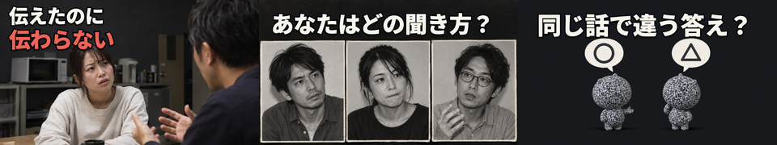
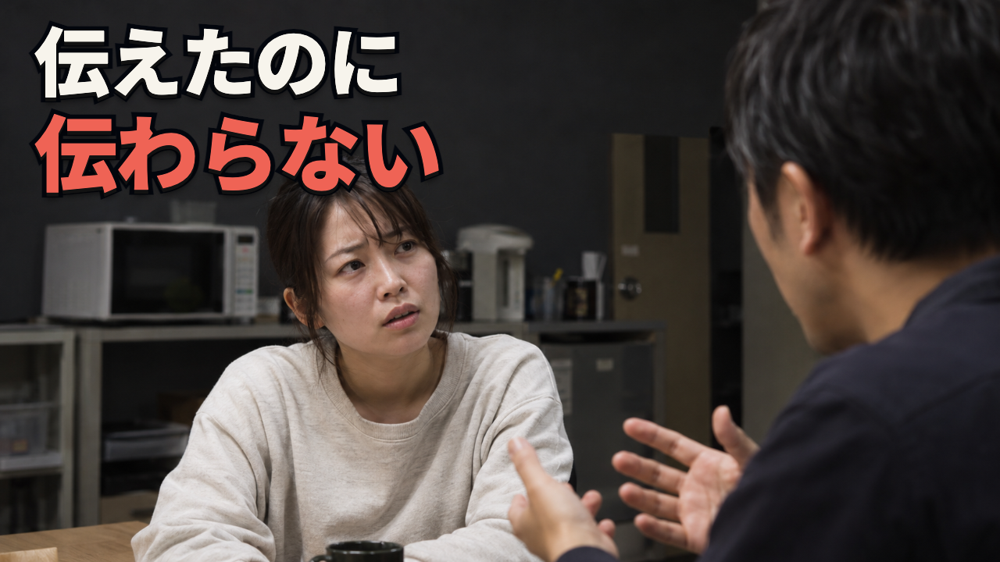
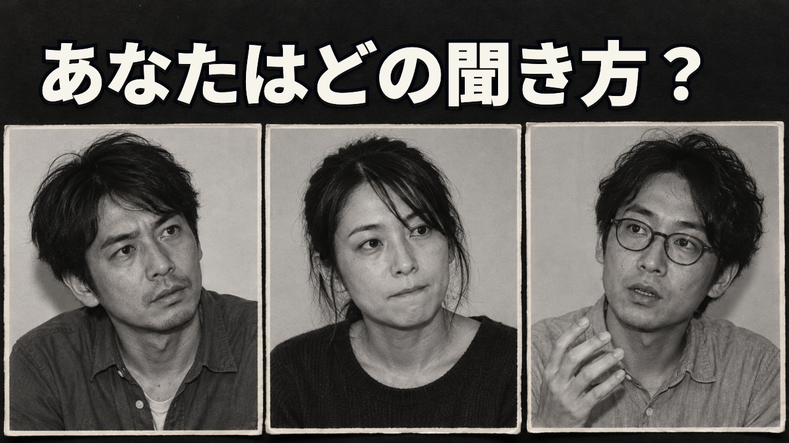
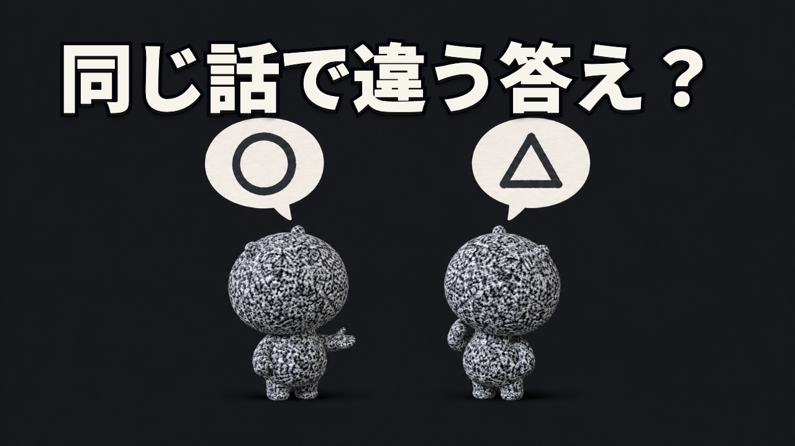

# 修正版：日常の会話が伝わるサムネ3案

2026-10-31。初稿に対する「AI生成感が強すぎてクリックされません」というユーザーの指摘を受けた修正版。**試作・Claude未監査・方向未選択**。クリック率の改善は未検証。

| 案 | コピー | 字数・行数 | 構図・主役 |
|---|---|---|---|
| 1 | 伝えたのに／伝わらない | 10字・2行 | 日常の会話の一瞬。説明する手と、理解を確かめようとする顔 |
| 2 | あなたはどの聞き方？ | 10字・1行 | 白黒の写真プリント3枚。集中・考える・尋ねるという反応の違い |
| 3 | 同じ話で違う答え？ | 9字・1行 | 同じ大きさのCRTマスコット2体。紙の吹き出しの丸・三角で食い違いを示す |

## 今回変えたこと

- ガラスの頭・頭内の図形・発光・艶の強い彫刻・豪華なCG背景を撤去。
- 案1は生活感のある服・肌・背景と自然な表情、案2は白黒写真の編集構成に変更。実在の人物を撮影した写真ではなく、架空の会話場面を生成した素材。
- 案3は奥行きと照明の演出を抑え、キャラ2体と吹き出しだけに整理。既存キャラの特徴は維持するが、同一メッシュではないため形状の厳密な一致は監査で確認する。
- 文字の発光を撤去。極太ゴシック・黒フチ・短い影を残し、案1の要点だけ赤で強調。
- 全案で人物・キャラを同等に扱い、IQの高低・病気・障害・優劣を示すラベルや顔を置かない。

## 原寸

### 案1：会話の場面（今回の推奨）

素材の珍しさではなく、「説明したのに伝わらない」という経験を入口にする。右の話し手と左の聞き手の関係が図形なしで伝わる。顔と文字を同時に読める構図。見下すラベルを入れず、どちらにも視聴者が重ねられる。

### 案2：聞き方の違い

人物を並べる勝ちパターンと視聴者への問いを維持。光る頭の比較を、日常の反応の比較へ変更。白黒写真＋白いコピーで競合の黄色帯と区別する。3人は医学的な3分類や診断結果を示さない。

### 案3：キャラで会話のズレを示す

同じキャラを同じ大きさで並べ、吹き出しの内容だけを変える。丸・三角は自作の比喩で、実際の検査問題ではない。ガラス・反射・発光ではなく、単純な形の違いで状況を伝える。顔なし・短い手足・全身の白黒CRTノイズは既存パイロット参照。

## ベンチマーク・素材・権利

土台は[既存107枚の分析](../../../thumb_benchmark_2026-10-31.md)。参考URL・取得日・再生数は[初稿の記録](../README.md)を継承。今回の採用パターンは人物の比較、視聴者への問い、短い最大文字、理解の食い違いへの疑問。全てを各案に機械的に盛り込まず、案1は具体的な場面、案2は比較と問い、案3はキャラと食い違いに重点を置く。ユーザーの修正指示を優先し、初稿の「神秘的な素材感」を抑えた。

- `assets/art_1.png`〜`art_3.png`: 内蔵image_genで新規生成。追加の有料API・キー・購入・契約は使っていない。実在人物の写真・実験画像として表示しない。生成指示は `prompts.md`。
- 案3の参照: 元の `pilots/sleep-emotion-60s/preview.mp4` の8秒。動画フレームや背景は素材として流用していない。
- `assets/IqRoughGothic-Black.otf`: Noto Sans CJK JP Black（900）の使用字サブセット。© 2014–2021 Adobe。SIL OFL 1.1、ライセンス全文は [../assets/OFL.txt](../assets/OFL.txt)。原フォントURLは初稿の素材記録を参照。
- 画像生成と文字組みは別工程。第三者のサムネ・キャラ・ロゴは使用していない。

## 検証と残件

1280×720 PNG・320×180縮小版を各3枚。字数10/10/9、最大2行、文字の画面内配置をチェック。原寸と320px比較画像を実見する。右下にコピー・顔・吹き出しを置かない。再書き出しは `node render.cjs`（Playwright・sharp・Chromiumが必要、任意のChromeは `CHROME_PATH`）。本編ファイルは変更していない。

**完成版の前に `01_research.md` の出典確認と、正式台本でコピーの約束が回収されるかの照合が必要。** 「話が通じない原因は4つ」「見た目で知能が分かる」とは主張しない。画像の人物は架空であり、表情から知能や障害を判定しない。

Claude監査と社長の方向選択は未完了。CTRや実際の視聴者反応は未測定で、「クリックされる」と実証した成果物ではない。旧案は比較履歴として残し、最新版はこのv2のみ。
