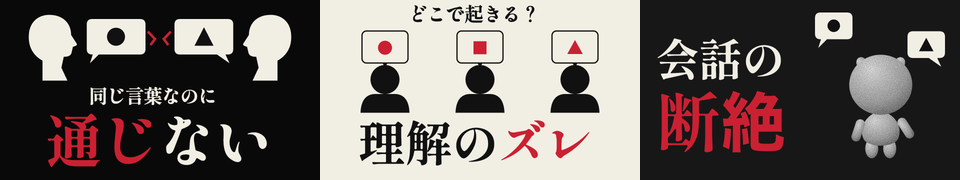
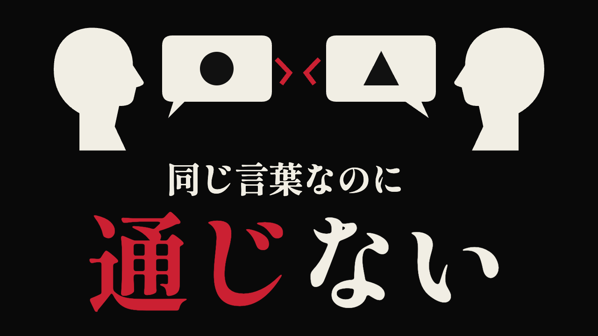
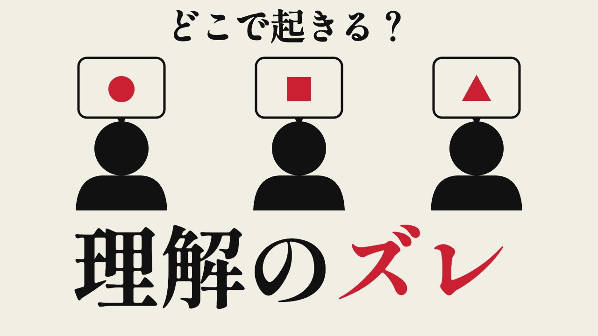
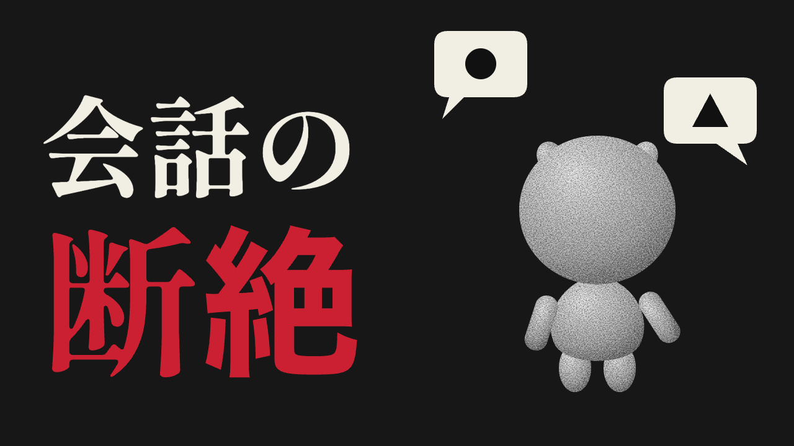

# v3：考えすぎる葦を参考にした図案中心の3案

2026-10-31。ユーザーの「YouTubeの“考えすぎる葦”のサムネを参考にして下さい」を優先した修正。**試作・Claude未監査・方向選択待ち**。

## 実画像を見て採用した特徴

参考チャンネルの5本を取得して直接実見した。下の[実見記録](benchmark.md)にURL・文言・構図・色・数字の出典を保存。

1. 具象的な写真ではなく、シルエット・ピクトグラムで人と人の関係や概念を伝える。
2. 大きな明朝体のキーワードと、小さな問いの大小差をつくる。
3. 黒・生成りを中心にし、注目する語や違いを赤で絞って強調する。白地の案も含む。

実画像は黒一色や明朝体だけに統一されているわけではない。「ユーモア」の例は白地・ゴシック・赤青。今回の採用は、5例に見られた文字優先と記号的な図案の方向である。

最新のユーザー指示に合わせ、従来の極太ゴシック・太フチ・発光・暗い背景限定から、明朝体・フチなし・白黒の地へ切り替えた。指示変更はこの試作に限り反映し、共通のAGENTS.md等は改変していない。

## 3案

| 案 | コピー | 合計字数・行数 | 構図 |
|---|---|---|---|
| 1 | 同じ言葉なのに／通じない | 11字・2行 | 黒地に向かい合う横顔。丸と三角の吹き出しが中央ですれ違う。下に大きな「通じない」 |
| 2 | どこで起きる？／理解のズレ | 12字・2行 | 生成り地に同じ大きさの人物3体。丸・四角・三角の理解の違い。下に大きな概念語 |
| 3 | 会話の／断絶 | 5字・2行 | 左に巨大な語、右に既存CRTキャラを元にした自作図案と異なる吹き出し |

### 案1（推奨）

題材の「話が通じない」が最短で伝わる。人物・会話・食い違いを一つの関係図にまとめ、画像の質感ではなく疑問に視線を集める。参考の「色気」の女性・目・脳・糸は使わず、新しい横顔と会話の構図にした。

### 案2

白地の参考例から、黒い人物と巨大な文字の読みやすさを採用。実際の検査問題や正解・不正解の例は使わず、三つの形を理解の違いの比喩にした。3人は3分類の研究上の主張ではない。全員を同じサイズ・同じ姿勢で描き、優劣をつけない。

### 案3

オリジナルキャラを継続登場させる案。`pilots/sleep-emotion-60s/` の形状・材質の記述と参照映像を元に、丸い大きな頭、上側の小さな耳、短い手足、顔なし、全身白黒ノイズをSVGで再構成。既存3Dメッシュのレンダーではなく、同キャラを図案化した試作である。形状とCRT材質の許容範囲は監査・方向選択時に確認する。画面下端や右下の時間表示領域に顔・コピー・吹き出しは置かない。

## 差別化と権利

- 参考動画の図柄・人物・キャラ・ロゴ・固有の文言は流用もトレースもしていない。図案は `render.cjs` で新規作成したSVG。競合サムネ画像はリポジトリ外の一時保存だけで、コミットしない。
- 特定の1本の構図・配色・文言の組み合わせを再現せず、今回の「会話の食い違い」に絞った独自の関係図にした。案3には自チャンネルのキャラを使う。
- v3は画像生成を使っていない。自作SVGと既存のOFLフォントのみ。追加の素材費・画像生成API・購入はない。
- フォント: Shippori Mincho B1 ExtraBold、Copyright 2021 The Shippori Mincho Project Authors、SIL OFL 1.1。原配布: https://github.com/fontdasu/ShipporiMincho 。ライセンス全文は `assets/OFL-ShipporiMinchoB1.txt`。既存ローカル素材をコピーして使用。
- `assets/art_1.svg`〜`art_3.svg` と文字は別工程。図の丸・四角・三角は概念の比喩で、研究データや検査問題ではない。

## 確認・再書き出し

1280×720 PNGと320×180縮小版を各3枚。コピーの字数11/12/5、最大2行、文字の境界が画面内に収まることを検証。320px比較画像とキャラの原寸を実見した。図案・文字ともスマホ幅で読めるか確認。CTRの改善は実証していない。

再書き出しは `node render.cjs`（既存のPlaywright、sharp、Chromiumが必要。任意のChromeを使う場合は `CHROME_PATH`）。同梱フォント・SVG生成コードからネット接続なしで書き出せる。本編・台本・企画本文は未変更。独立した試作のため本編用Remotionコマンドとtscは未実施。

**完成版の前に `01_research.md` の出典と正式台本での約束回収を確認する。** 元企画の「原因は4つ」は承認していない。IQの数値や診断は入れていない。Claude監査と社長の方向選択までは完成版に進まない。マージ・公開なし。
