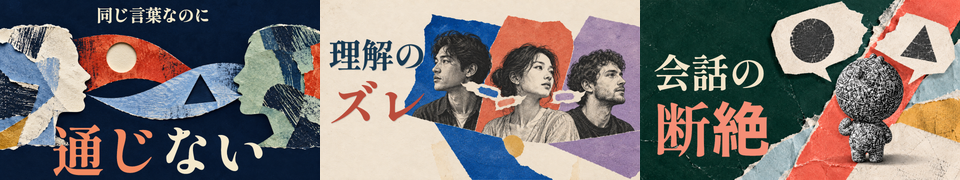
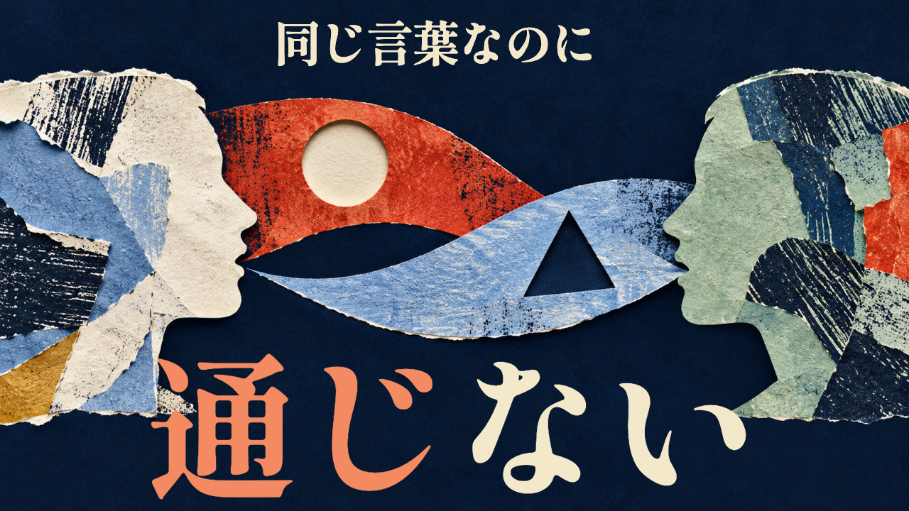
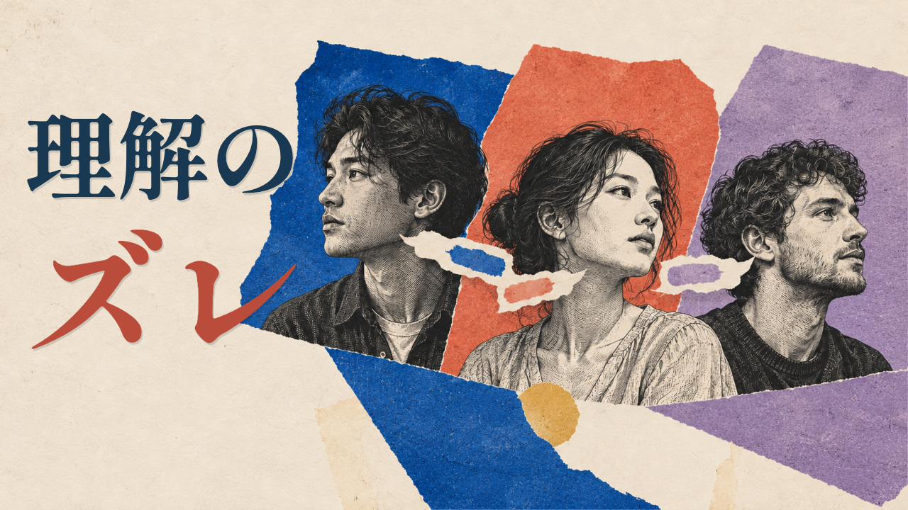
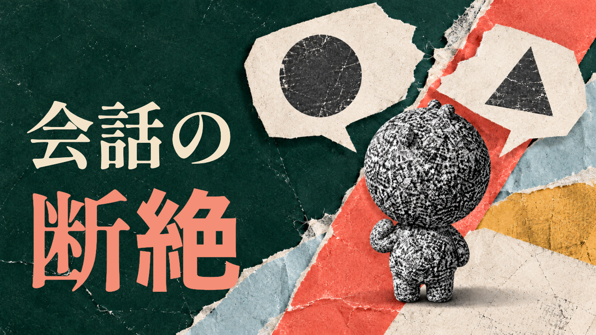

# v4：紙と版画のコラージュによるサムネ3案

**切り絵・版画案は不採用（ユーザー指示：「視認性が悪く不採用」「色が薄くインパクトがありません」）。最新版は [v5](../v5/README.md)。以下は比較履歴。**

2026-10-31。ユーザーの「シンプルすぎてもっとデザイン性が欲しい。色も3色にこだわらなくていいです」を反映。**試作・Claude未監査・方向未選択**。

## 変更点

「考えすぎる葦」を参考にした大きな明朝体と概念を示す図は継承。v3の単純なアイコン配置から、紙の重なり、版画の線、ちぎれた輪郭、斜めの構成へ変えた。色数を3色に限定せず、人物・会話・解釈の違いを見分けるために色を使う。AI生成感への以前の指摘も保持し、光沢CGや発光ではなく印刷物・紙の質感を選んだ。

| 案 | コピー | 字数・行数 | デザイン |
|---|---|---|---|
| 1 | 同じ言葉なのに／通じない | 11字・2行 | 紺・生成り・青緑・朱・水色・黄土。横顔を紙の層で組み、すれ違う会話を帯として交差させる |
| 2 | 理解の／ズレ | 5字・2行 | 生成り・コバルト・朱・ラベンダー・墨・黄土。版画調の架空の人物3人と、傾いた色面のコラージュ |
| 3 | 会話の／断絶 | 5字・2行 | 深緑・コーラル・淡い青・黄土・生成り。CRTキャラの背後に斜めの紙面を重ね、異なる吹き出しを配置 |

### 案1

頭の形と会話の帯を画面の端まで広げ、下の主コピーを大きく重ねる。左右の横顔は同等に扱う。丸・三角は解釈の違いを示す比喩で、正誤や知能の順位を示さない。

### 案2

大きな文字を左に寄せ、右の人物と色面を密に重ねた。人物は同程度の大きさで、表情の優劣をつけない。途中生成に含まれた建築・植物等は題材と無関係なため取り除いた。実在の人物や歴史的肖像の転用ではない。

### 案3

キャラだけを無地に置く構成から、紙の切れ目と会話の断絶を結び付けた構成へ変更。既存のパイロット8秒を参照し、大きな丸い頭・小さい耳・短い手足・顔なし・全身の白黒CRTノイズを維持するよう生成。一度の修正で両腕・両脚が分かるようにした。同一3Dメッシュではなく再描画のため、厳密な形状一致は監査対象。

## 素材・再現

- `assets/art_1.png`〜`art_3.png`: 内蔵image_genで新規生成した紙・版画調の図像。競合画像・キャラ・ロゴは流用していない。生成指示と修正指示は [prompts.md](prompts.md)。途中の不採用素材はコミットしない。
- 画像生成と文字組みは別工程。文字はShippori Mincho B1 ExtraBold（SIL OFL 1.1）。フォント本体・著作権表示・ライセンスは [../v3/assets/](../v3/assets/) を再利用する。原配布: https://github.com/fontdasu/ShipporiMincho 。
- 案3参照はリポジトリの `pilots/sleep-emotion-60s/preview.mp4`。動画フレームの背景や構図を使用していない。
- 外部の課金API・キー・追加購入・新規契約なし。既存チャットの内蔵機能を使用。実在の実験写真・測定画像として扱わない。
- 競合分析は [v3の5本実見記録](../v3/benchmark.md) を継承。色数の制限と単純な図案配置は最新のユーザー指示により変更した。共通ルールファイルは変更していない。
- 再書き出し: `node render.cjs`（Playwright・sharp・Chromium。任意のChromeは `CHROME_PATH`）。同梱素材とv3のフォントで再現し、書き出し時にネット接続は不要。

## 確認・残件

1280×720・320×180を各3枚。コピーは11/5/5字・最大2行。文字領域内、右下にコピー・顔・吹き出しがないこと、320px比較画像、案1・案2の原寸を確認。生成素材のキャラの両手足も確認。本編や既存サムネは未変更。独立した静止画レンダーであり本編のRemotionコマンド・tscは未実施。

**完成版の前に `01_research.md` の出典と正式台本で約束の回収を確認する。** 元企画の「原因は4つ」を承認していない。人物3人や図形は研究分類・診断結果ではない。CTR改善は未測定。Claude監査と社長の方向選択待ちで、ゲートA承認・完成版・マージ・公開ではない。
