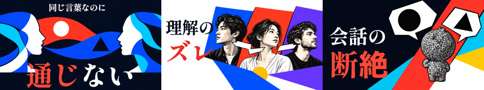
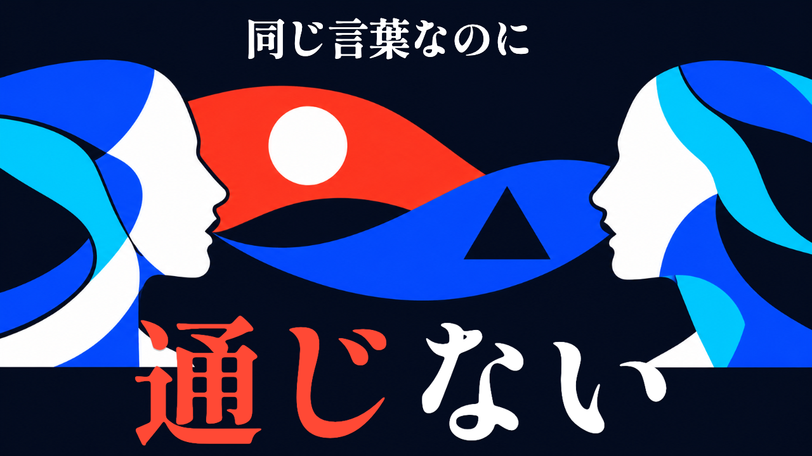
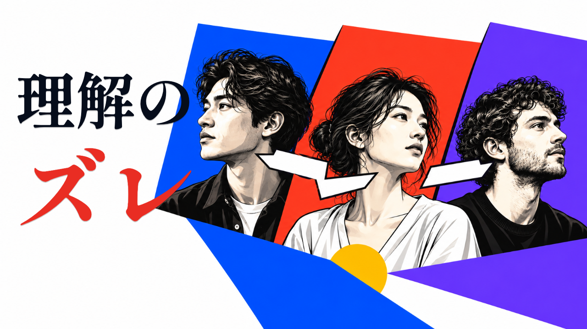
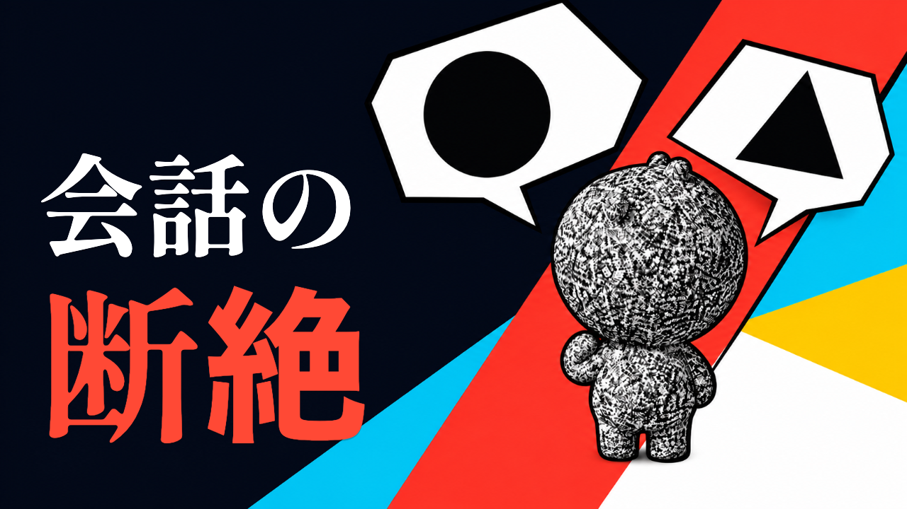

# v5：構図を残し、色と輪郭を強めた3案

2026-10-31。ユーザーの「紙絵と版画は視認性が悪く不採用。デザインは悪くないが色が薄くインパクトがない」を反映。**試作・Claude未監査・方向未選択**。

## 修正内容

- v4の横顔と会話の帯、人物の重なり、キャラ背後の斜めの構図は継承。
- 紙の繊維、ちぎれた輪郭、版画の細かい線、淡い生成り・くすんだ青緑・ラベンダーを撤去。
- 濃紺・白・朱・鮮明な青・シアン・紫を使い、輪郭を明瞭にした。人物と隣り合う色面の境界にも明暗差をつける。
- 「考えすぎる葦」を参考にした大きな明朝体は継承。コピーとレイアウトをなるべく変えず、視認性を比較できるようにした。

| 案 | コピー | 字数・行数 | 特徴 |
|---|---|---|---|
| 1 | 同じ言葉なのに／通じない | 11字・2行 | 濃紺地、白い横顔、朱と青の会話の帯。形を大きく明瞭に区切る |
| 2 | 理解の／ズレ | 5字・2行 | 白地と黒い文字。白黒を中心とした人物に青・朱・紫の背景面を重ねる |
| 3 | 会話の／断絶 | 5字・2行 | 濃紺地と白・朱の文字。キャラの白黒CRT材質を残し、背景を鮮明な色面にする |

### 案1

### 案2

### 案3

## 素材・確認

内蔵image_genでv4の文字なし素材を編集。生成・修正指示は [prompts.md](prompts.md)。外部の課金API・キー・追加購入・新規契約なし。第三者のサムネ・キャラ・ロゴは使わない。人物・図形は架空の比喩であり、研究画像・診断結果・IQの序列ではない。案3は既存パイロット参照のキャラを引き継ぐが、同一3Dメッシュではないため形状の厳密な一致は監査対象。

文字は画像生成後に別工程で配置。Shippori Mincho B1 ExtraBold（SIL OFL 1.1）の本体・著作権表示・ライセンスは [v3/assets](../v3/assets/) を再利用。原配布 https://github.com/fontdasu/ShipporiMincho 。競合は [v3で実見した5本](../v3/benchmark.md)の記録を継承。

1280×720・320×180を各3枚。11/5/5字・最大2行、文字の画面内配置、右下にコピー・顔・吹き出しがないこと、320px比較画像を確認。`node render.cjs`（Playwright・sharp・Chromium、任意ブラウザは `CHROME_PATH`）で再書き出し可能。素材とv3フォントをローカルから読むため書き出し時のネット接続は不要。

**完成版の前に `01_research.md` の出典と正式台本での約束回収を確認する。** 元企画の「原因は4つ」を承認していない。CTR改善は未測定。Claude監査・社長の方向選択待ち。本編・台本・既存サムネを変更せず、独立した静止画のみをレンダーしたため本編のRemotionコマンド・tscは未実施。マージ・公開なし。
