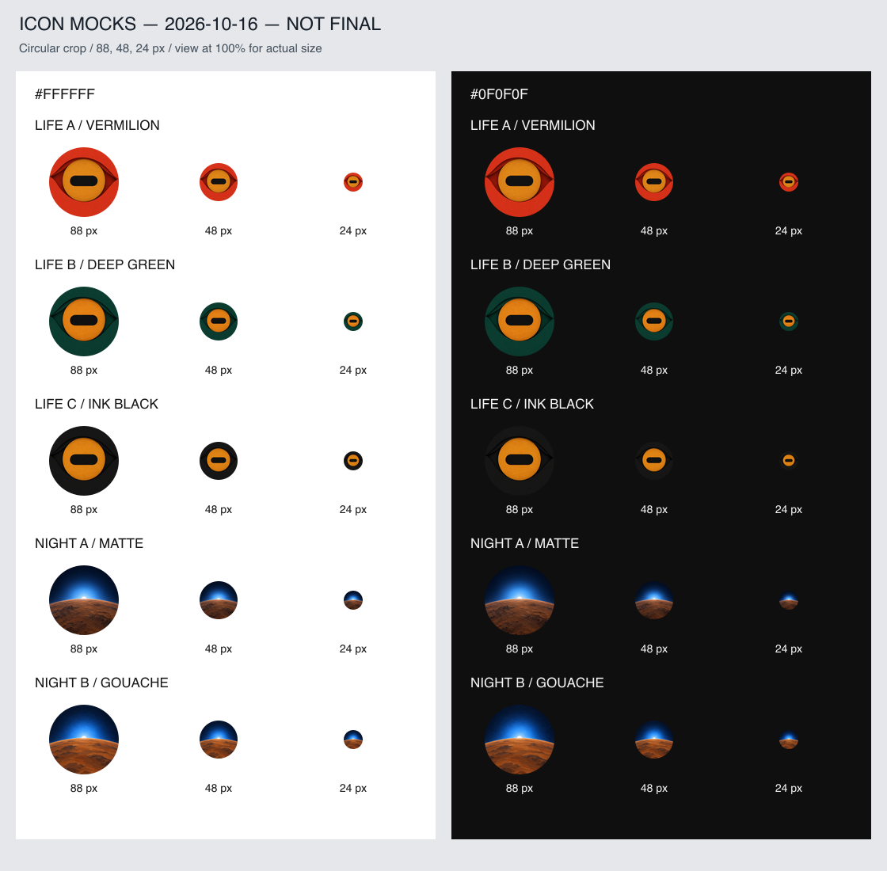

# 新規2チャンネル アイコン・モック

**モック／社長未選択／最終版ではありません。Claude監査待ち。**

生成日：2026-10-16（JST）

## 承認方針と範囲

- 正：`docs/チャンネル方針.md` の2026-10-16の3行。
- 確認した設計ブランチ：`claude/eloquent-wozniak-81iras`、コミット `d9a9612cc8ddd9194605df3428cd65beb18b56e0`。
- 今回のユーザー依頼によりCodexがアイコン制作、Claudeが監査。既存のサムネ用工程とは別の承認済み制作依頼。
- 指定どおり生物3色、宇宙2質感。文字・ロゴ・透かしなし。各PNGは1024×1024、sRGB。
- 虹彩・瞳孔と太陽・青い光の中心を中央80%円内に配置。周辺の皮膚と地平線は指定どおり画面外へ続く。
- 他者画像・ロゴ・キャラの流用、トレース、外部参考画像の入力なし。画像入力を使ったのは今回自分で生成したモックの編集のみ。

## 使用ツール・追加費用

全5案：Codex内蔵 `image_gen.imagegen`（imagegenスキルのbuilt-in mode）。APIキー、外部画像生成API、追加クレジット購入、有料素材、有料サービスは使用していない。ユーザーの「サブスク枠内のみ」の許可に従う経路で生成し、追加支出の操作は0。アカウントの請求明細を参照する機能はなく、請求額の独立した照合まではしていない。

正方形の生成原本をローカルのSharpで1024×1024 PNGに統一。Sharpは同梱済みで追加購入なし。画像の創作・色変更・質感変更は内蔵画像生成で行い、ローカル処理はサイズ統一、円形マスク、縮小一覧への配置のみ。

## ファイルと生成手順

|案|ファイル|使用ツール・生成手順|
|---|---|---|
|生物A 朱赤|`life-a-vermilion.png`|image_gen：P1新規→P2で虹彩の放射状の細片を除去|
|生物B 深緑|`life-b-green.png`|image_gen：生物AをP3で色変更|
|生物C 墨黒|`life-c-ink.png`|image_gen：生物AをP4で色変更|
|宇宙A マット写実|`night-a-matte.png`|image_gen：P5新規|
|宇宙B ガッシュ|`night-b-gouache.png`|image_gen：宇宙AをP6で質感変更|

生成編集では厳密なピクセル固定までは保証されない。生物は構図・瞳孔を固定する指示で色だけを変更したが微細な紙目の差がある。宇宙Bには質感に伴う地面の明度差もある。これらを完全に同一条件の測定結果とは扱わない。

## NASA/JPLの事実確認

- [Sunset in Mars’ Gale Crater — PIA19400](https://www.jpl.nasa.gov/images/pia19400-sunset-in-mars-gale-crater/)
- 公開2015-05-08。CuriosityのMastcamによる2015-04-15（sol 956）の夕日について、火星大気中の微細な塵により太陽の近くに青色が残り、日没近くに効果が強くなるとの説明を本文で確認。確認日2026-10-16。
- ページの文章のみ確認。探査車画像はダウンロード・生成入力・構図参考・トレースのいずれにも使っていない。
- 今回のアイコンは青い夕日という事実を着想とした創作。強い青、暗い空、大きく湾曲した地平線はブランドの図像表現であり、実際の探査車の視野・色・縮尺を再現したものではない。

## 縮小一覧



`contact_sheet.png`は1120×1100。左背景#FFFFFF、右背景#0F0F0F。各行の左から88px・48px・24px。円形マスクを適用。ブラウザやチャットの自動縮小では実寸にならないため、100%表示で確認する。

## 自己評価（Codexの目視・視聴者テストではない）

|案|24pxでの判読|誤読・トーンの懸念|記憶する言葉／評価|
|---|---|---|---|
|生物A|円形の琥珀と黒い横長瞳孔、赤い外縁が残る。目として読める|瞳孔の横棒はマイナス記号にも見え得る。単眼なのでオカルト連想を完全には排除できない。半目や顔文字には見えにくいという主観評価|「朱赤の横長の瞳」。色で最も目に留まる候補|
|生物B|目と切り絵の外縁が残る。暗背景でも虹彩は明瞭|外縁はAより沈むが、記号だけにはなりにくい。非特定種だが横長瞳孔から有蹄類を連想する可能性は残る|「深緑の横長の瞳」。落ち着いた候補|
|生物C|虹彩と瞳孔は残るが暗背景で周囲の縁がかなり消える|目より横棒入りの円・マイナス記号に見える懸念が3案中最大。自己評価は要検討|「黒地の横長の瞳」。優先順位は低め|
|宇宙A|地平線と青い光は読める。白い芯は24pxで約1〜2pxになる|質感は縮小で失われる。睡眠BGM・SFの連想は否定できず、画像単独で科学チャンネルだと断定不可|「夕日が青い」。88pxでは写実の質感が特徴|
|宇宙B|琥珀の地面と青い光の分離がAより明瞭。白芯も残る|静かな絵画調。24pxではAとの差は主に明暗・色面になり、画材の違いまで読めない。睡眠BGM連想は残る|「夕日が青い」。小サイズはBが暫定有力|

両宇宙案とも星、宇宙船、人物、ネオン線、レンズフレア、環はなし。青い光は線描の輪ではなく拡散光として表現。生物はまつ毛・血管・濡れたハイライトなし。紙の縁の影は一段で、初稿の多数の虹彩細片は削除済み。

**推奨は生物AまたはB、宇宙B。ただし監査合格・社長選択を意味しない。**

## Claudeへの監査依頼

実画像と縮小一覧を開いて、①承認行との一致 ②24pxでの判読 ③生物の半目・顔文字・オカルト・記号への誤読 ④宇宙の睡眠BGM／SF・ゲーム連想 ⑤生物3案が色比較、宇宙2案が質感比較として妥当か ⑥権利・追加支出経路・出典・生成履歴を確認してください。画像が見えない場合は合格にせず、その旨を返してください。選択は社長に留保します。

## 使用プロンプト全文

### P1

```text
Create a single original icon mock, square exactly 1024x1024 PNG. Minimal sophisticated paper-cut illustration of one non-species-specific living animal eye. Large completely circular amber-ochre iris centered at (512,512), diameter about 570px, clearly visible as a circle. Inside it a BLACK HORIZONTAL ROUNDED RECTANGLE pupil width about 340px height 125px, absolutely not vertical, not slit eyelids. Eye around iris is a broad open organic aperture, partial single dark vermilion paper edge of skin/fur extending to frame edges without recognizable species features. Solid VERMILION RED #C94430 background. 2–3 flat paper layers, one subtle single drop shadow, crisp deliberately cut contours, restrained minimal grain. Graphic editorial sophistication not children's craft, not realistic. Main iris/pupil entirely within central circle 80% canvas diameter. No eyelashes, wet gloss, veins, highlights, occult triangles, face, extra eyes, text, letters, logo, watermark. This is an eye with horizontal pupil, not a half-closed eye. No reference images. Fill full square with background, no pre-cropped circle.
```

### P2

```text
Edit this original generated icon only: remove all radial iris streaks and extra layered shard textures. Iris must be a single flat amber-ochre paper disk with only subtle fine paper grain, not dozens of radial strips. Keep exactly same geometry, framing, horizontal rounded black pupil, vermilion background, partial darker red outer skin-paper edge, one shallow shadow. Two or three sheets total. No extra text, logo, watermark. Output square 1024x1024 PNG. This is an original generated mock, no third-party reference.
```

### P3

```text
Edit this original generated icon into background variant B. Change ONLY the vermilion red background paper and darker red surrounding eye-edge paper to DEEP GREEN #123D34 and a matching darker green edge. Preserve exact circular amber-ochre iris, flat paper texture, black horizontal rounded rectangular pupil, geometry, placement, shadow, crop and all details. No red remains. No new elements, text, logo or watermark. Square exactly 1024x1024 PNG. Use the supplied original generated mock only, no external references.
```

### P4

```text
Edit this original generated icon into background variant C. Change ONLY the vermilion red background paper and darker red surrounding eye-edge paper to INK BLACK #191919 and a matching near-black edge. Preserve exact circular amber-ochre iris, flat paper texture, black horizontal rounded rectangular pupil, geometry, placement, shadow, crop and all details. No red or green remains. No new elements, text, logo or watermark. Square exactly 1024x1024 PNG. Use the supplied original generated mock only, no external references.
```

### P5

```text
Create an original square icon mock, exactly 1024x1024 PNG. Quiet blue sunset on an alien rocky planet. Composition precisely centered: huge gently convex rusty amber planetary horizon arc fills entire lower half, crest at x512 y550, arc drops toward left and right and bleeds off both sides and bottom, no whole planet disk floating in space. Small pure white solar core diameter about 64px, half submerged at crest of horizon, surrounded by a large luminous electric-blue atmospheric glow radius about 180px, soft continuous broad blue diffusion NOT a drawn ring, not neon. Near-black navy sky occupying upper half. Main white sun and blue glow within central circular safe area 80% canvas width. Matte photorealistic calm tactile dusty terrain, restrained natural subtle texture, atmospheric cinematic minimalism but NOT science fiction or game concept art. No stars, spacecraft, people, silhouettes, Saturn rings, neon lines, light streaks, lens flare, text, logos, watermark, or extra celestial bodies. No reference images; original generation from text. Symbolic icon inspired only by the factual existence of bluish Martian sunsets, not a documentary reconstruction.
```

### P6

```text
Edit this original generated blue sunset mock into variant B: change ONLY the surface rendering to a quiet sophisticated gouache painting, opaque matte broad painted color planes, restrained fine paper grain. Preserve EXACT composition, positions, scale, horizon curvature, rusty amber terrain color, near-black navy upper sky, small white half-sun at center of horizon and broad electric-blue glow size and distribution. Render dusty terrain with a few broad calm planes instead of photographic rocks. Avoid thick impasto and cartoon outlines. No stars, neon lines, lens flare, spaceships, people, text, logo, watermark or added elements. Not game or SF art. Square exactly 1024x1024 PNG. Only supplied original generated mock is an edit target, no third-party reference.
```
